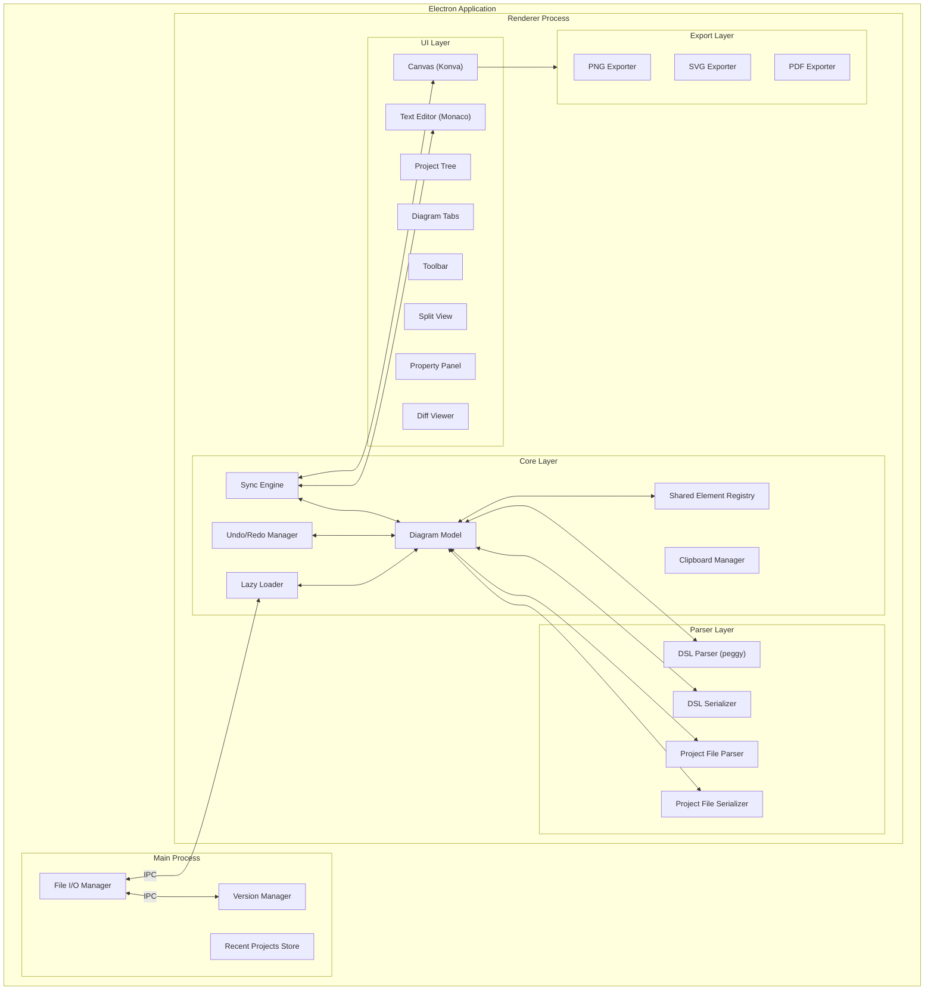
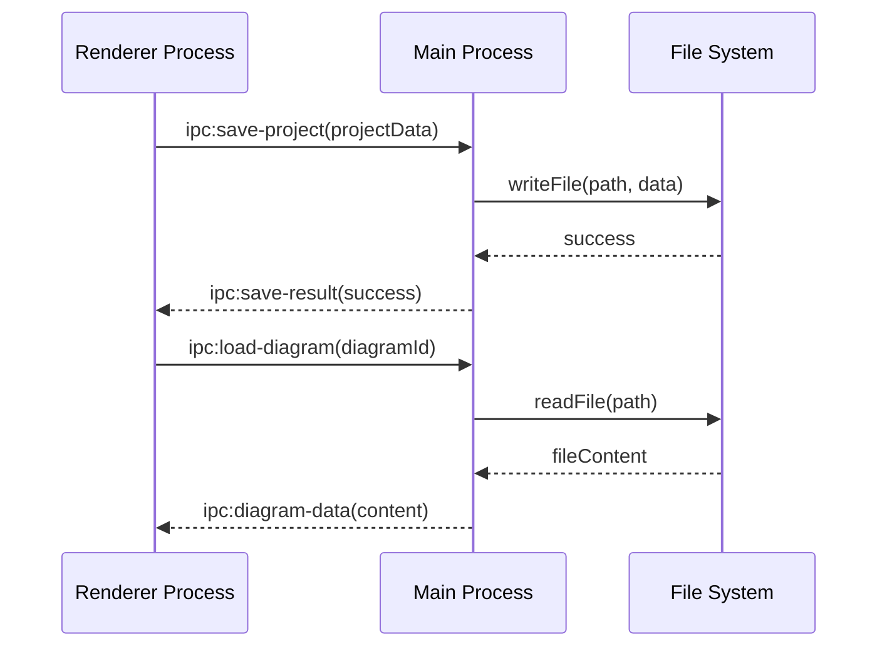
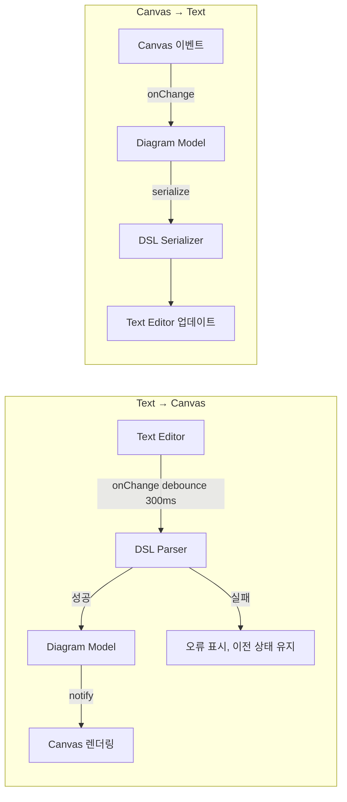

# 설계 문서: UML 데스크탑 클라이언트

## 개요

UML 데스크탑 클라이언트는 텍스트 DSL과 GUI Canvas를 실시간 양방향 동기화하는 하이브리드 UML 편집기이다. Electron + React 기반 크로스 플랫폼 데스크탑 애플리케이션으로, 로컬 파일 시스템에 모든 데이터를 저장한다.

핵심 설계 원칙:
- **DSL-First**: 모든 다이어그램 데이터는 텍스트 DSL로 정의되며, Canvas는 DSL의 시각적 표현이다
- **단일 진실 공급원(Single Source of Truth)**: 내부 다이어그램 모델이 유일한 데이터 소스이며, DSL 텍스트와 Canvas는 이 모델의 뷰이다
- **지연 로딩**: 대규모 프로젝트에서 필요한 데이터만 점진적으로 로드한다
- **참조 공유**: Shared_Element는 단일 인스턴스로 관리되며 여러 다이어그램에서 참조한다

### 기술 스택

| 영역 | 기술 | 선택 근거 |
|------|------|-----------|
| 런타임 | Electron | 크로스 플랫폼 데스크탑, Node.js 파일 시스템 접근 |
| UI 프레임워크 | React + TypeScript | 컴포넌트 기반 UI, 타입 안전성 |
| Canvas 렌더링 | HTML5 Canvas (Konva.js) | 고성능 2D 렌더링, 드래그/줌/패닝 내장 지원 |
| 텍스트 편집기 | Monaco Editor | VSCode 기반, 구문 강조/자동완성/오류 표시 내장 |
| DSL 파서 | PEG.js (peggy) | PEG 문법 기반 파서 생성기, 오류 위치 보고 지원 |
| 상태 관리 | Zustand | 경량 상태 관리, 구독 기반 업데이트 |
| 파일 형식 | JSON (프로젝트 파일), 커스텀 DSL (다이어그램 텍스트) | JSON은 구조화 데이터에 적합, DSL은 사람이 읽기 쉬움 |
| 내보내기 | html2canvas (PNG), SVG 직접 생성, jsPDF (PDF) | 각 형식에 최적화된 라이브러리 |
| 테스트 | Vitest + fast-check | 단위 테스트 + 속성 기반 테스트 |

## 아키텍처

### 전체 아키텍처 다이어그램



### 프로세스 간 통신

Electron의 Main Process와 Renderer Process 간 IPC(Inter-Process Communication)를 사용한다:

- **Main Process**: 파일 시스템 I/O, 버전 관리(스냅샷 저장/복원), 최근 프로젝트 목록 관리
- **Renderer Process**: UI 렌더링, 다이어그램 모델 관리, 파싱/직렬화, 동기화 엔진




## 컴포넌트 및 인터페이스

### 1. DSL Parser / Serializer

DSL은 각 다이어그램 유형별로 텍스트 문법을 정의한다. peggy(PEG.js)를 사용하여 파서를 생성한다.

```typescript
// DSL Parser 인터페이스
interface DSLParseResult {
  success: true;
  diagram: DiagramData;
} | {
  success: false;
  errors: DSLError[];
}

interface DSLError {
  line: number;
  column: number;
  message: string;
  expected?: string[];
}

interface DSLParser {
  parse(dslText: string): DSLParseResult;
}

interface DSLSerializer {
  serialize(diagram: DiagramData): string;
}
```

DSL 문법 예시 (클래스 다이어그램):
```
@class-diagram "주문 시스템"

class Order {
  - id: string
  - items: OrderItem[]
  + addItem(item: OrderItem): void
  + calculateTotal(): number
}

class OrderItem {
  - product: Product
  - quantity: number
}

Order "1" --> "*" OrderItem : contains
```

### 2. Project File Parser / Serializer

프로젝트 파일은 JSON 형식으로 저장된다. 프로젝트 메타데이터, 트리 구조, 공유 요소 레지스트리, 각 다이어그램 데이터를 포함한다.

```typescript
interface ProjectFileParser {
  /** 프로젝트 메타데이터와 트리 구조만 파싱 (지연 로딩용) */
  parseMetadata(content: string): ProjectMetadata;
  /** 특정 다이어그램 데이터 파싱 */
  parseDiagram(content: string, diagramId: string): DiagramData;
  /** 전체 프로젝트 파싱 */
  parseAll(content: string): ProjectData;
}

interface ProjectFileSerializer {
  serialize(project: ProjectData): string;
}
```

### 3. Sync Engine

Text Editor와 Canvas 간 실시간 양방향 동기화를 담당한다. 디바운싱을 적용하여 빈번한 업데이트를 최적화한다.

```typescript
interface SyncEngine {
  /** Text Editor 변경 → 모델 업데이트 → Canvas 반영 */
  onTextChange(newText: string): void;
  /** Canvas 변경 → 모델 업데이트 → Text Editor 반영 */
  onCanvasChange(change: CanvasChange): void;
  /** 동기화 일시 중지/재개 (대량 작업 시) */
  pause(): void;
  resume(): void;
}

type CanvasChange =
  | { type: 'element-add'; element: DiagramElement }
  | { type: 'element-move'; elementId: string; position: Position }
  | { type: 'element-resize'; elementId: string; size: Size }
  | { type: 'element-delete'; elementId: string }
  | { type: 'element-update'; elementId: string; properties: Partial<ElementProperties> }
  | { type: 'connector-add'; connector: Connector }
  | { type: 'connector-delete'; connectorId: string }
  | { type: 'connector-waypoint'; connectorId: string; waypoints: Position[] };
```

동기화 흐름:



### 4. Undo/Redo Manager

Command 패턴 기반으로 모든 편집 작업을 추적한다. Text Editor와 Canvas 양쪽의 변경을 통합 관리한다.

```typescript
interface Command {
  execute(): void;
  undo(): void;
  description: string;
}

interface UndoManager {
  execute(command: Command): void;
  undo(): void;
  redo(): void;
  canUndo(): boolean;
  canRedo(): boolean;
  /** 최소 50단계 이력 유지 */
  readonly maxHistory: number;
}
```

### 5. Lazy Loader

대규모 프로젝트에서 다이어그램 데이터를 필요 시점에 로드하고, LRU 캐시로 메모리를 관리한다.

```typescript
interface LazyLoader {
  /** 프로젝트 메타데이터만 로드 */
  loadProjectMetadata(path: string): Promise<ProjectMetadata>;
  /** 특정 다이어그램 데이터 로드 (캐시 확인 후) */
  loadDiagram(diagramId: string): Promise<DiagramData>;
  /** 다이어그램 로드 상태 */
  getLoadState(diagramId: string): 'unloaded' | 'loading' | 'loaded';
  /** 메모리 임계값 초과 시 LRU 해제 */
  evictLRU(): void;
}

interface LRUCache<K, V> {
  get(key: K): V | undefined;
  set(key: K, value: V): void;
  delete(key: K): void;
  readonly size: number;
  readonly maxSize: number;
}
```

### 6. Shared Element Registry

여러 다이어그램에서 참조되는 공유 요소를 단일 인스턴스로 관리한다.

```typescript
interface SharedElementRegistry {
  /** 공유 요소 등록 */
  register(element: DiagramElement): SharedElementRef;
  /** 공유 요소 조회 */
  get(refId: string): DiagramElement | undefined;
  /** 공유 요소 속성 업데이트 (모든 참조에 전파) */
  update(refId: string, properties: Partial<ElementProperties>): void;
  /** 특정 다이어그램에서 참조 제거 */
  removeReference(refId: string, diagramId: string): void;
  /** 공유 요소를 참조하는 다이어그램 목록 */
  getReferencingDiagrams(refId: string): string[];
  /** 공유 요소 완전 삭제 */
  delete(refId: string): void;
}
```

### 7. Version Manager

로컬 파일 시스템에 스냅샷을 저장하고 관리한다.

```typescript
interface VersionManager {
  createSnapshot(project: ProjectData, message: string): Promise<Snapshot>;
  getHistory(projectPath: string): Promise<Snapshot[]>;
  restoreSnapshot(snapshotId: string): Promise<ProjectData>;
  deleteSnapshot(snapshotId: string): Promise<void>;
  diff(snapshotIdA: string, snapshotIdB: string): Promise<DiffResult>;
}

interface Snapshot {
  id: string;
  createdAt: Date;
  message: string;
  projectDataPath: string;
}

interface DiffResult {
  added: DiffEntry[];
  modified: DiffEntry[];
  deleted: DiffEntry[];
  dslTextDiff: TextDiff[];
}

interface DiffEntry {
  diagramId: string;
  diagramName: string;
  elementChanges: ElementChange[];
}
```

### 8. Export Engine

다이어그램을 PNG, SVG, PDF 형식으로 내보낸다.

```typescript
interface ExportEngine {
  exportPNG(diagram: DiagramData, options: ExportOptions): Promise<Buffer>;
  exportSVG(diagram: DiagramData, options: ExportOptions): Promise<string>;
  exportPDF(diagram: DiagramData, options: ExportOptions): Promise<Buffer>;
}

interface ExportOptions {
  scale?: number;
  backgroundColor?: string;
  padding?: number;
}
```

### 9. Clipboard Manager

다이어그램 요소의 복사/잘라내기/붙여넣기를 관리한다.

```typescript
interface ClipboardManager {
  copy(elements: DiagramElement[], connectors: Connector[]): void;
  cut(elements: DiagramElement[], connectors: Connector[]): void;
  paste(targetPosition: Position): { elements: DiagramElement[]; connectors: Connector[] };
  hasContent(): boolean;
}
```

## 데이터 모델

### 프로젝트 데이터 구조

```typescript
interface ProjectData {
  metadata: ProjectMetadata;
  tree: ProjectTreeNode[];
  sharedElements: Record<string, DiagramElement>;
  diagrams: Record<string, DiagramData>;
}

interface ProjectMetadata {
  name: string;
  version: string;
  createdAt: string;
  updatedAt: string;
  /** 다이어그램 ID → 메타데이터 (지연 로딩용) */
  diagramIndex: Record<string, DiagramMeta>;
}

interface DiagramMeta {
  id: string;
  name: string;
  type: DiagramType;
  parentFolderId: string;
}

interface ProjectTreeNode {
  id: string;
  name: string;
  type: 'folder' | 'diagram';
  diagramType?: DiagramType;
  children?: ProjectTreeNode[];
  expanded?: boolean;
}
```

### 다이어그램 데이터 구조

```typescript
type DiagramType = 'class' | 'sequence' | 'usecase' | 'activity' | 'state';

interface DiagramData {
  id: string;
  name: string;
  type: DiagramType;
  elements: DiagramElement[];
  connectors: Connector[];
  viewport: Viewport;
}

interface Viewport {
  x: number;
  y: number;
  zoom: number; // 0.25 ~ 4.0
}

interface Position {
  x: number;
  y: number;
}

interface Size {
  width: number;
  height: number;
}
```

### 다이어그램 요소

```typescript
interface DiagramElement {
  id: string;
  type: ElementType;
  position: Position;
  size: Size;
  properties: ElementProperties;
  /** 공유 요소인 경우 참조 ID */
  sharedRefId?: string;
}

type ElementType =
  // 클래스 다이어그램
  | 'class' | 'interface' | 'abstract-class' | 'enum'
  // 시퀀스 다이어그램
  | 'lifeline' | 'activation' | 'message'
  // 유스케이스 다이어그램
  | 'actor' | 'usecase' | 'system-boundary'
  // 액티비티 다이어그램
  | 'action' | 'decision' | 'fork' | 'join' | 'initial-node' | 'final-node'
  // 상태 다이어그램
  | 'state' | 'initial-state' | 'final-state' | 'composite-state'
  // 공통
  | 'note' | 'package';

interface ElementProperties {
  name: string;
  stereotype?: string;
  visibility?: 'public' | 'private' | 'protected' | 'package';
  attributes?: Attribute[];
  methods?: Method[];
  description?: string;
  [key: string]: unknown;
}

interface Attribute {
  name: string;
  type: string;
  visibility: 'public' | 'private' | 'protected' | 'package';
  isStatic?: boolean;
}

interface Method {
  name: string;
  returnType: string;
  parameters: Parameter[];
  visibility: 'public' | 'private' | 'protected' | 'package';
  isStatic?: boolean;
  isAbstract?: boolean;
}

interface Parameter {
  name: string;
  type: string;
}
```

### 커넥터(관계)

```typescript
interface Connector {
  id: string;
  type: ConnectorType;
  sourceId: string;
  targetId: string;
  waypoints?: Position[];
  label?: string;
  sourceMultiplicity?: string;
  targetMultiplicity?: string;
  properties: ConnectorProperties;
}

type ConnectorType =
  | 'association' | 'directed-association'
  | 'aggregation' | 'composition'
  | 'inheritance' | 'realization'
  | 'dependency' | 'usage'
  // 시퀀스 다이어그램
  | 'sync-message' | 'async-message' | 'return-message'
  // 유스케이스 다이어그램
  | 'include' | 'extend'
  // 액티비티/상태 다이어그램
  | 'transition';

interface ConnectorProperties {
  lineStyle?: 'solid' | 'dashed';
  arrowStyle?: 'open' | 'closed' | 'diamond' | 'diamond-filled';
  [key: string]: unknown;
}
```

### 프로젝트 파일 구조 (파일 시스템)

```
my-project/
├── project.uml.json          # 프로젝트 메타데이터 + 트리 구조 + 공유 요소
├── diagrams/
│   ├── class-order.uml       # 개별 다이어그램 DSL 파일
│   ├── class-user.uml
│   ├── seq-login.uml
│   └── ...
└── .versions/
    ├── snapshots.json         # 스냅샷 인덱스
    ├── snap-001/              # 스냅샷 데이터
    │   ├── project.uml.json
    │   └── diagrams/
    └── snap-002/
        ├── project.uml.json
        └── diagrams/
```

설계 결정: 각 다이어그램을 개별 DSL 파일로 저장하여 외부 AI 도구가 파일 시스템에서 직접 DSL 파일을 생성/수정할 수 있도록 한다. `project.uml.json`은 프로젝트 구조와 공유 요소 레지스트리를 관리하며, 지연 로딩 시 이 파일만 먼저 읽어 트리 구조를 구성한다.

### 버전 관리 데이터

```typescript
interface SnapshotIndex {
  projectPath: string;
  snapshots: SnapshotEntry[];
}

interface SnapshotEntry {
  id: string;
  createdAt: string;
  message: string;
  /** 스냅샷 디렉토리 상대 경로 */
  path: string;
}

interface TextDiff {
  diagramId: string;
  diagramName: string;
  hunks: DiffHunk[];
}

interface DiffHunk {
  oldStart: number;
  oldLines: number;
  newStart: number;
  newLines: number;
  lines: DiffLine[];
}

interface DiffLine {
  type: 'add' | 'remove' | 'context';
  content: string;
}
```

## 정확성 속성 (Correctness Properties)

*속성(Property)은 시스템의 모든 유효한 실행에서 참이어야 하는 특성 또는 동작이다. 속성은 사람이 읽을 수 있는 명세와 기계가 검증할 수 있는 정확성 보장 사이의 다리 역할을 한다.*

### Property 1: 프로젝트 파일 라운드트립

*For any* 유효한 다이어그램 데이터 구조에 대해, Pretty_Printer로 직렬화한 후 Parser로 파싱하면 원본과 동일한 데이터 구조를 생성해야 한다.

**Validates: Requirements 6.4, 6.1, 6.2**

### Property 2: DSL 라운드트립

*For any* 유효한 다이어그램 데이터 구조에 대해, DSL_Serializer로 직렬화한 후 DSL_Parser로 파싱하면 원본과 동일한 데이터 구조를 생성해야 한다.

**Validates: Requirements 14.6, 14.3, 14.4**

### Property 3: 공유 요소 참조 보존 라운드트립

*For any* Shared_Element를 포함하는 프로젝트 데이터에 대해, 직렬화 후 파싱하면 동일한 Shared_Element를 참조하는 모든 다이어그램에서 단일 인스턴스로 복원되어야 하며, 모든 참조 관계가 보존되어야 한다.

**Validates: Requirements 6.6, 6.7**

### Property 4: 공유 요소 업데이트 전파 및 참조 독립성

*For any* 여러 다이어그램에서 참조되는 Shared_Element에 대해, 속성을 수정하면 모든 참조 다이어그램에서 변경이 반영되어야 하며, 특정 다이어그램에서 참조를 제거해도 원본과 다른 다이어그램의 참조는 영향받지 않아야 한다.

**Validates: Requirements 11.1, 11.2, 11.3**

### Property 5: 실행 취소/다시 실행 라운드트립

*For any* 편집 작업에 대해, 실행 후 취소하면 이전 상태로 복원되어야 하며, 취소 후 다시 실행하면 편집 후 상태와 동일해야 한다.

**Validates: Requirements 4.1, 4.2**

### Property 6: 실행 취소 이력 크기 불변량

*For any* N개의 편집 작업 시퀀스(N > 50)에 대해, 실행 취소 이력은 최소 50단계를 유지해야 한다.

**Validates: Requirements 4.3**

### Property 7: 새 편집 후 다시 실행 이력 초기화

*For any* 편집 작업 시퀀스에서, 실행 취소 후 새로운 편집 작업을 수행하면 다시 실행 이력이 비어 있어야 한다.

**Validates: Requirements 4.4**

### Property 8: 요소 삭제 시 커넥터 연쇄 제거

*For any* 다이어그램과 그 안의 Diagram_Element에 대해, 해당 요소를 삭제하면 그 요소에 연결된 모든 Connector도 함께 제거되어야 한다.

**Validates: Requirements 3.4**

### Property 9: 양방향 동기화 일관성

*For any* Text_Editor 또는 Canvas에서의 유효한 변경에 대해, 변경 후 Diagram Model을 통해 반대쪽 뷰에 반영된 결과는 원본 변경과 의미적으로 동일해야 한다.

**Validates: Requirements 15.1, 15.2, 15.5, 15.6**

### Property 10: 동기화 오류 복구

*For any* 유효한 DSL 상태 이후 유효하지 않은 DSL 텍스트가 입력되면, Canvas의 다이어그램 모델은 마지막으로 유효했던 상태를 유지해야 한다.

**Validates: Requirements 15.4**

### Property 11: 클립보드 복사-붙여넣기 데이터 보존

*For any* 선택된 Diagram_Element 집합과 그 사이의 Connector에 대해, 복사 후 붙여넣기하면 원본과 동일한 속성을 가진 새 요소가 생성되어야 하며, 요소 간 Connector 관계도 보존되어야 한다.

**Validates: Requirements 8.1, 8.2, 8.4**

### Property 12: DSL 파서 오류 보고 완전성

*For any* 유효하지 않은 DSL 텍스트에 대해, DSL_Parser는 오류 위치(행, 열)와 원인을 포함한 오류 메시지를 반환해야 한다.

**Validates: Requirements 14.5, 6.3**

### Property 13: 스냅샷 복원 라운드트립

*For any* 프로젝트 상태에 대해, 스냅샷을 생성한 후 프로젝트를 수정하고 해당 스냅샷으로 복원하면 스냅샷 생성 시점의 상태와 동일해야 한다.

**Validates: Requirements 19.5**

### Property 14: 스냅샷 메타데이터 완전성 및 시간순 정렬

*For any* 생성된 스냅샷 시퀀스에 대해, 각 스냅샷은 생성 시각, 설명 메시지, 고유 식별자를 포함해야 하며, 버전 이력은 시간순으로 정렬되어야 한다.

**Validates: Requirements 19.3, 19.4**

### Property 15: 프로젝트 트리 검색 필터 정확성

*For any* 검색어와 프로젝트 트리에 대해, 반환된 모든 항목은 다이어그램 이름 또는 요소 이름에서 검색어와 일치해야 한다.

**Validates: Requirements 13.1**

### Property 16: 최근 프로젝트 목록 크기 불변량

*For any* 프로젝트 열기 시퀀스에 대해, 최근 프로젝트 목록은 최대 10개를 초과하지 않아야 하며, 역시간순으로 정렬되어야 한다.

**Validates: Requirements 1.5**

### Property 17: 다이어그램 유형별 도구 모음 유효성

*For any* 다이어그램 유형에 대해, Toolbar에 표시되는 Diagram_Element 도구는 해당 다이어그램 유형에 유효한 요소 유형의 부분집합이어야 한다.

**Validates: Requirements 2.7**

### Property 18: LRU 캐시 메모리 관리

*For any* 다이어그램 접근 시퀀스에 대해, 메모리 사용량이 임계값을 초과하면 가장 오래 사용되지 않은 다이어그램 데이터가 해제되어야 하며, 캐시된 다이어그램은 재로드 없이 접근 가능해야 한다.

**Validates: Requirements 12.4, 12.5**

## 오류 처리

### 파싱 오류

| 오류 상황 | 처리 방식 |
|-----------|-----------|
| 유효하지 않은 Project_File | Parser가 오류 위치와 원인을 포함한 `DSLError[]` 반환. UI에 오류 메시지 표시 |
| 유효하지 않은 DSL 텍스트 | DSL_Parser가 행/열 위치와 원인 반환. Text_Editor에 인라인 오류 마커 표시 |
| DSL 구문 오류 중 동기화 | Sync_Engine이 마지막 유효 상태를 Canvas에 유지. 오류 해결 시 자동 동기화 재개 |

### 파일 I/O 오류

| 오류 상황 | 처리 방식 |
|-----------|-----------|
| 파일 읽기 실패 | 사용자에게 오류 메시지 표시, 최근 프로젝트 목록에서 해당 항목 비활성화 |
| 파일 쓰기 실패 | 사용자에게 오류 원인 표시 (디스크 공간 부족, 권한 없음 등), 다른 위치에 저장 제안 |
| 프로젝트 파일 손상 | 가능한 범위까지 파싱 시도, 복구 불가능한 부분은 오류 보고 |

### 내보내기 오류

| 오류 상황 | 처리 방식 |
|-----------|-----------|
| 렌더링 실패 | Export_Engine이 오류 원인을 포함한 메시지 반환, 사용자에게 표시 |
| 파일 저장 실패 | 저장 위치 변경 제안 |

### 버전 관리 오류

| 오류 상황 | 처리 방식 |
|-----------|-----------|
| 스냅샷 생성 실패 | 디스크 공간 확인 후 오류 메시지 표시 |
| 스냅샷 복원 실패 | 스냅샷 데이터 손상 시 오류 메시지 표시, 현재 상태 유지 |
| 스냅샷 없는 상태에서 되돌리기 | "사용 가능한 스냅샷이 없습니다" 메시지 표시 |

### 대규모 프로젝트 오류

| 오류 상황 | 처리 방식 |
|-----------|-----------|
| 다이어그램 로드 실패 | 해당 다이어그램 탭에 오류 메시지 표시, 다른 다이어그램 작업 계속 가능 |
| 메모리 부족 | LRU 캐시 적극적 해제, 사용자에게 경고 메시지 표시 |
| 대량 DSL 붙여넣기 오류 | 파싱 오류 시 붙여넣기 이전 상태 유지, 오류 위치 표시 |

### 공유 요소 오류

| 오류 상황 | 처리 방식 |
|-----------|-----------|
| 중복 요소 이름 (붙여넣기 시) | 사용자에게 처리 방법 확인 (덮어쓰기, 이름 변경, 건너뛰기) |
| 공유 요소 원본 삭제 시도 | 영향받는 다이어그램 목록 표시 후 삭제 확인 요청 |

## 테스트 전략

### 이중 테스트 접근법

이 프로젝트는 단위 테스트와 속성 기반 테스트(PBT)를 병행하여 포괄적인 테스트 커버리지를 확보한다.

### 속성 기반 테스트 (Property-Based Testing)

- **라이브러리**: fast-check (TypeScript/JavaScript용 PBT 라이브러리)
- **테스트 프레임워크**: Vitest
- **최소 반복 횟수**: 각 속성 테스트당 100회 이상
- **태그 형식**: `Feature: uml-desktop-client, Property {number}: {property_text}`

속성 기반 테스트 대상:
- Property 1: 프로젝트 파일 라운드트립 (serialize → parse → compare)
- Property 2: DSL 라운드트립 (serialize → parse → compare)
- Property 3: 공유 요소 참조 보존 라운드트립
- Property 4: 공유 요소 업데이트 전파 및 참조 독립성
- Property 5: 실행 취소/다시 실행 라운드트립
- Property 6: 실행 취소 이력 크기 불변량
- Property 7: 새 편집 후 다시 실행 이력 초기화
- Property 8: 요소 삭제 시 커넥터 연쇄 제거
- Property 9: 양방향 동기화 일관성
- Property 10: 동기화 오류 복구
- Property 11: 클립보드 복사-붙여넣기 데이터 보존
- Property 12: DSL 파서 오류 보고 완전성
- Property 13: 스냅샷 복원 라운드트립
- Property 14: 스냅샷 메타데이터 완전성 및 시간순 정렬
- Property 15: 프로젝트 트리 검색 필터 정확성
- Property 16: 최근 프로젝트 목록 크기 불변량
- Property 17: 다이어그램 유형별 도구 모음 유효성
- Property 18: LRU 캐시 메모리 관리

### 단위 테스트 (Example-Based)

단위 테스트는 구체적인 시나리오, 엣지 케이스, UI 상호작용을 검증한다:

- 프로젝트 생성/저장/열기 기본 흐름
- 각 다이어그램 유형 생성 (스모크 테스트)
- Canvas 요소 배치, 이동, 크기 조절
- 내보내기 기본 흐름 (PNG, SVG, PDF)
- 프로젝트 트리 CRUD 작업
- 다이어그램 탭 전환 동작
- 분할 뷰 모드 전환
- 저장하지 않은 변경사항 확인 대화 상자
- 대량 DSL 붙여넣기 시 중복 요소 처리
- 스냅샷 없는 상태에서 되돌리기 시도 (엣지 케이스)

### 통합 테스트

- 파일 시스템 I/O (프로젝트 저장/로드)
- 내보내기 파일 생성 및 유효성 검증
- 스냅샷 파일 시스템 저장/복원
- 대규모 프로젝트 지연 로딩 (50개 이상 다이어그램)

### 테스트 생성기 (Generators)

fast-check 생성기를 구현하여 다양한 테스트 데이터를 자동 생성한다:

```typescript
// 주요 생성기
const arbDiagramType: fc.Arbitrary<DiagramType>;
const arbPosition: fc.Arbitrary<Position>;
const arbSize: fc.Arbitrary<Size>;
const arbAttribute: fc.Arbitrary<Attribute>;
const arbMethod: fc.Arbitrary<Method>;
const arbDiagramElement: fc.Arbitrary<DiagramElement>;
const arbConnector: fc.Arbitrary<Connector>;
const arbDiagramData: fc.Arbitrary<DiagramData>;
const arbProjectData: fc.Arbitrary<ProjectData>;
const arbDSLText: fc.Arbitrary<string>; // 유효한 DSL 텍스트
const arbInvalidDSLText: fc.Arbitrary<string>; // 유효하지 않은 DSL 텍스트
const arbEditCommand: fc.Arbitrary<Command>; // 편집 명령
const arbSnapshot: fc.Arbitrary<Snapshot>;
```
